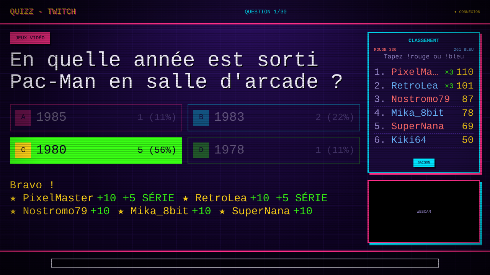
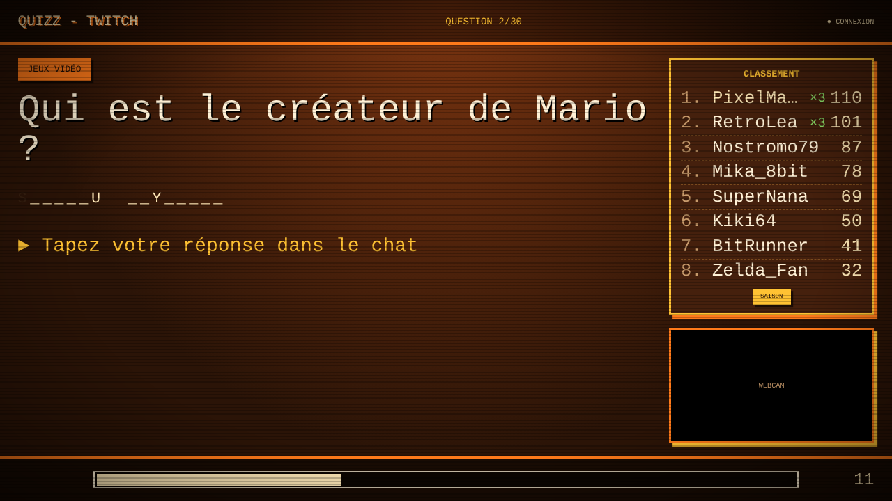
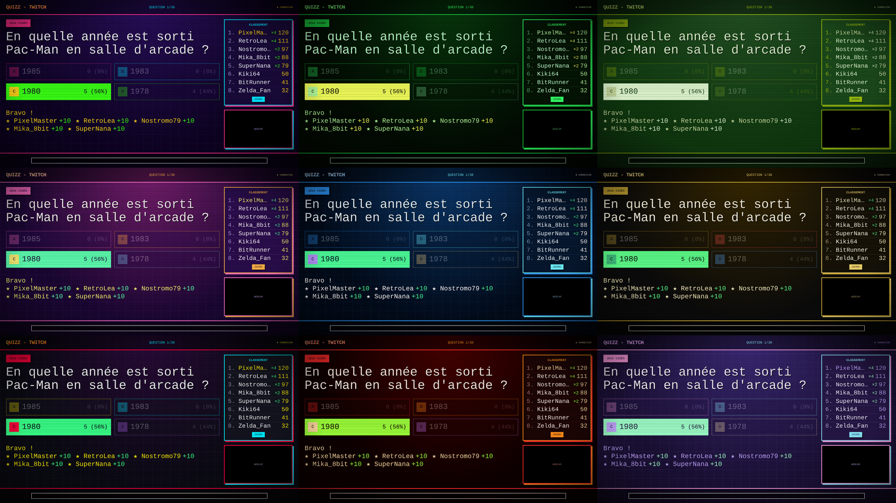
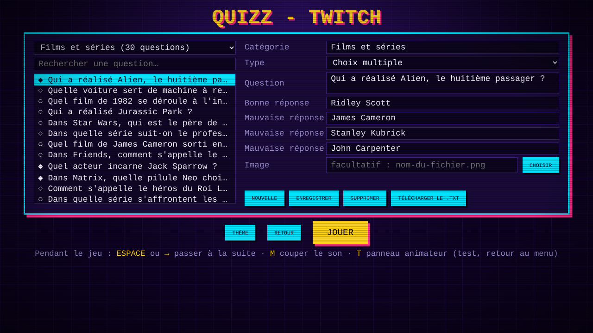

# Quizz - Twitch

**Un jeu de quiz façon émission télé, joué en direct par ton chat Twitch.**

Tu lances le jeu sur ton ordinateur, tu le captures dans OBS, et tes spectateurs répondent en écrivant dans le chat. Le jeu compte les points, tient le classement et anime la partie tout seul.

Un seul fichier HTML, rien à installer, pas de compte ni de clé Twitch à créer.



## Pourquoi l'essayer

- **Prêt en deux minutes** : tu ouvres le fichier dans ton navigateur, tu écris le nom de ta chaîne, tu cliques sur JOUER.
- **300 questions fournies** dans 10 catégories, et un éditeur intégré pour ajouter les tiennes.
- **20 thèmes visuels** et 5 polices, du néon d'arcade au terminal vert, avec ton titre et ton image de fond.
- **Un emplacement pour ta webcam** sous le classement.
- **Windows, Mac et Linux** : il suffit d'un navigateur récent (Chrome, Edge, Firefox).

## Démarrage rapide

1. Télécharge le dépôt (bouton **Code**, puis **Download ZIP**) et décompresse-le.
2. Ouvre `Quizz - Twitch.html` dans ton navigateur.
3. Écris le nom de ta chaîne dans **Chaîne Twitch**. Envoie un message dans ton chat : il doit s'afficher sous le champ, et le voyant passe à **EN LIGNE**.
4. Clique sur **CHOISIR** et sélectionne `questions.txt`.
5. Clique sur **JOUER**.

### Dans OBS

- Ajoute une source **Capture de fenêtre** sur la fenêtre du navigateur, en plein écran (touche F11).
- Pose ta source **webcam** par-dessus le cadre noir « WEBCAM » et ajuste sa taille. Le cadre est au format 16:9.
- Garde la fenêtre du jeu visible pendant le live : ne la réduis pas dans la barre des tâches.

## Comment joue le chat

| Type de question | Ce que tape le spectateur | Points |
| --- | --- | --- |
| Choix multiple | `A`, `B`, `C` ou `D` | 5 points, plus jusqu'à 5 points de rapidité |
| Question ouverte | La réponse, directement dans le chat | 10 points pour le premier qui trouve |
| Question image | La réponse, directement dans le chat | De 10 à 7 points selon la netteté de l'image |

Le jeu ignore les majuscules, les accents et les articles, et tolère les petites fautes de frappe. Seule la première réponse de chaque spectateur compte sur un choix multiple.

Le réglage **Retard du stream** laisse quelques secondes de plus au chat après la fin du chrono, pour compenser le décalage de la diffusion.

## Ce qui anime la partie



- **Indices progressifs** : sur une partie des questions ouvertes, la réponse s'affiche en tirets et quelques lettres apparaissent en fondu. Chaque lettre coûte 1 point.
- **Questions image** : l'image apparaît en gros pixels puis devient nette.
- **Joker 50/50** : au hasard, sur quelques choix multiples, deux mauvaises réponses disparaissent en cours de question.
- **Séries** : 3 bonnes réponses d'affilée rapportent 5 points de bonus.
- **Classement de saison** : les points se cumulent d'un live à l'autre. Le bouton **SAISON**, sous le classement, bascule entre la partie et la saison.

## Les modes de jeu

- **Classique** : chacun pour soi.
- **Équipes** : les spectateurs tapent `!rouge` ou `!bleu` pour choisir leur camp. Le score des deux équipes s'affiche au-dessus du classement.
- **Le chat contre le streamer** : tu réponds au clavier dans la fenêtre du jeu, sans que rien ne s'affiche à l'écran. Un point par question pour toi, un point pour le chat.
- **Mort subite** : une partie entière en choix multiples, où une erreur élimine. Le dernier en jeu gagne 50 points.

### Les manches finales

- **Manche à mise** : avant la dernière question, chacun parie ses points avec `!mise 20` ou `!mise tout`. Bonne réponse, la mise est gagnée ; sinon elle est perdue.
- **Mort subite entre les 3 meilleurs** : les trois premiers s'affrontent jusqu'à ce qu'il n'en reste qu'un.

## 20 thèmes



Le bouton **THÈME** de l'écran d'accueil permet de choisir :

- un thème parmi 20 (Arcade néon, Terminal vert, Console de poche, Plateau télé 70, Cyberpunk, Film d'horreur…) ;
- une police parmi 5 ;
- le titre et le sous-titre de ton émission ;
- une image de fond, avec un curseur pour l'assombrir ;
- l'effet d'écran cathodique et l'affichage du cadre webcam.

Les changements s'appliquent en direct et restent mémorisés.

## Tes propres questions

### Avec l'éditeur intégré



Le bouton **QUESTIONS** ouvre un éditeur pour chercher, modifier, ajouter et supprimer des questions. Les changements sont pris en compte tout de suite. Clique sur **TÉLÉCHARGER LE .TXT** pour enregistrer le fichier à jour sur ton ordinateur.

### À la main, dans un fichier texte

Le fichier de questions est un simple `.txt` :

```ini
[Géographie]
Quelle est la capitale de l'Australie ? = Canberra
Quel est le plus long fleuve d'Afrique ? = *Le Nil | Le Congo | Le Niger | Le Zambèze

[Histoire]
Qui a été le premier président de la Cinquième République ? = Charles de Gaulle | De Gaulle

[Drapeaux]
{drapeau-japon.png} De quel pays est-ce le drapeau ? = Japon
```

- `[Nom]` ouvre une catégorie.
- `Question = réponse` crée une question ouverte. Sépare plusieurs réponses acceptées par `|`.
- Une étoile `*` devant une réponse crée un choix multiple : il faut exactement 4 réponses, et l'étoile marque la bonne.
- `{image.png}` devant la question crée une question image. Range l'image dans le dossier `images`, à côté du jeu.
- Une ligne qui commence par `#` est un commentaire.

Le fichier `questions-images-exemple.txt` montre trois questions image prêtes à tester.

## Commandes de l'animateur

| Touche | Action |
| --- | --- |
| `Espace`, `Entrée` ou `→` | Passer à la suite (révéler la réponse, question suivante) |
| `M` | Couper ou remettre le son |
| `T` | Ouvrir le panneau animateur : simuler des messages du chat, revenir au menu, vider la saison |

Le panneau animateur permet de tester une partie complète sans être en live : écris `pseudo: message` et valide.

## Contenu du dépôt

| Fichier | Rôle |
| --- | --- |
| `Quizz - Twitch.html` | Le jeu complet |
| `questions.txt` | 300 questions dans 10 catégories |
| `questions-images-exemple.txt` | Trois questions image d'exemple |
| `images/` | Les images des questions image |
| `docs/` | Les captures d'écran de cette page |

## Bon à savoir

- Le jeu **lit** le chat sans compte ni clé, mais il **n'écrit pas** dans le chat.
- Une connexion internet est nécessaire pour lire le chat et charger les polices.
- Les réglages, le thème, les questions modifiées et la saison sont mémorisés dans le navigateur. Si tu changes de navigateur ou d'ordinateur, emporte ton fichier `questions.txt`.
- Les 300 questions fournies ont été relues, mais une erreur reste possible : signale-la dans les *Issues* du dépôt.
# Quizz-Twitch
Un quizz pour vos streams Twitch utilisable en un claquement de doigt ! 
